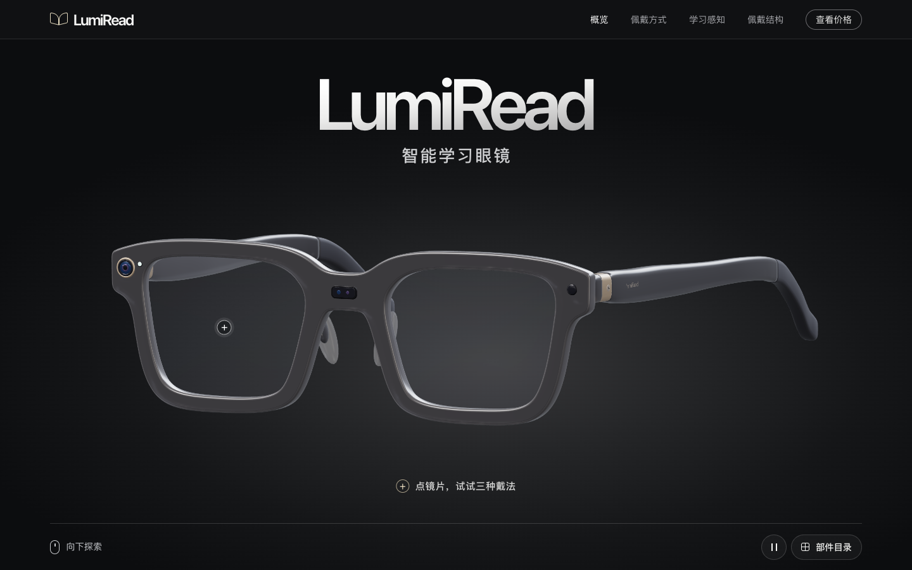

# LumiRead · 智能学习眼镜

LumiRead 是一个面向纸面作业的无屏学习眼镜概念原型。在桌面浏览器里，家长可以上传数学作业、查看逐题批改、订正答案，再根据最近的作答练习一道推荐题。产品展示页可在 3D 视图中切换无镜片、防蓝光无度数镜片和夹片款三种佩戴方式。联邦学习实验页可以逐轮回放模型训练，比较不同方法对下一题答对概率的预测。

[实验结果摘要](docs/PUBLIC_RESULTS.md) · [商业与机器学习报告（英文 PDF）](reports/LumiRead_Business_and_ML.pdf) · [路演演示稿（下载 HTML 后用浏览器打开）](reports/LumiRead_Roadshow.html)



## 在本机运行

准备 Python 3.11、uv、Node.js 22+、pnpm 和 make，在项目根目录执行以下命令。

```sh
make bootstrap
make demo-accounts
make verify-models federated-check
make demo
```

首次创建演示账号时，程序会下载指定版本的 ASSISTments 数据，校验 SHA-256，再从验证集重建三个匿名学习者的作答历史。如果已有同一份 ZIP，可将第二条命令换成 `make demo-accounts ARCHIVE=/absolute/path/to/assistments2009.zip`。知识追踪模型随仓库提供，可直接在 CPU 上运行。[数据来源与重建步骤](data/dkt/README.md)

如需使用在线批改，在启动服务前将 `OPENAI_API_KEY` 配置到后端环境变量或 `apps/api/.env`。可从 `apps/api/.env.example` 复制配置，并用 `OPENAI_MODEL` 指定账号可访问的图像模型。批改时，后端将作业图像发给所配置的视觉服务，调用按提供商规则计费。本机数据库与上传图片保存在 `var/`。

| 本机入口 | 可以尝试 |
| --- | --- |
| [产品展示](http://127.0.0.1:8742/showcase) | 转动眼镜，查看框架结构和佩戴方式。 |
| [家长学习手册](http://127.0.0.1:8742/app) | 选择「登录 B」，在「作业批改」依次上传[原题页](data/demo/worksheet-original.png)与[订正页](data/demo/worksheet-revised.png)。第二题的答案由 8 改为 5，可对照两次判分。 |
| [联邦学习实验](http://127.0.0.1:8742/federated) | 查看三次 FedAvg 实验的验证曲线、测试指标与通信量。 |

家长手册还可以回放工作距离与照度。每个演示账号配对了同一名成年受试者公开记录中的一个时间窗，回放保留原始时间与测量值。学习历史和护眼记录来自两个独立研究。[Clouclip 记录与取样规则](data/clouclip/README.md)

## 实验结果

六类数学知识点的预测任务按学生划分训练、验证与测试集。下表使用同一批 355 名留出学生的 6,694 次首次作答。家长手册使用集中式 DKT 更新个人预测，LightGBM 在三种方法中取得最高的测试 ROC AUC。

| 方法 | 测试 ROC AUC |
| --- | ---: |
| LightGBM | 0.7024 |
| 集中式 LSTM DKT | 0.6894 |
| FedAvg DKT（验证集选定模型） | 0.6646 |

FedAvg 在一台机器上模拟 1,653 个学生客户端，每轮抽取 64 个，独立运行三个随机种子，每个种子训练 60 轮。三个种子的测试 ROC AUC 均值为 0.6576，样本标准差为 0.0061。[模型卡](docs/MODEL_CARD.md) · [联邦实验完整结果](artifacts/federated/report.json)

另一次在线批改评估通过常规上传入口提交了 24 张程序排版的数学作业截图。六类题型各 20 题，120 题全部获得自动判分，其中 119 题与预先计算的答案一致（99.17%）。这次评估只覆盖排版截图，真实手写字迹、倾斜拍摄和阴影条件下的准确率仍待评估。[逐题批改汇总指标](reports/vision_evaluation.json)

## 仓库导览

| 目录 | 内容 |
| --- | --- |
| `apps/web`、`apps/api` | React / TypeScript 前端，FastAPI 后端、批改任务和 SQLite 存储。 |
| `ml`、`artifacts` | 集中式与联邦训练代码、LightGBM 基线、冻结权重、评估结果和校验值。 |
| `data`、`packages/contracts` | 数据来源、知识点映射、演示题页及前后端接口定义。 |
| `scripts`、`tests` | 本机启动和验证脚本、模型与应用回归测试。 |

已完成账号数据重建后，运行 `make test-accounts test-clouclip test-grading test-learning-loop` 可以检查账号隔离、传感器回放、批改修订与练习流程。

在 Git 克隆中运行 `make package`，可将当前提交的公开源码和许可证导出到 `release/LumiRead-source.zip`。

## 许可与数据来源

LumiRead 的原创代码采用 [MIT 许可证](LICENSE)。第三方数据和素材遵循各自的来源条款。ASSISTments 学生级记录由使用者从数据发布方独立获取。Clouclip 示例附有上游 MIT 许可。归档视觉实验的照度表格和手写视频分别采用 CC BY 4.0 和 CC BY 3.0。[ASSISTments 数据说明](data/dkt/README.md) · [Clouclip 许可](data/clouclip/LICENSE) · [视觉实验署名与许可](data/vision/original/README.md)
