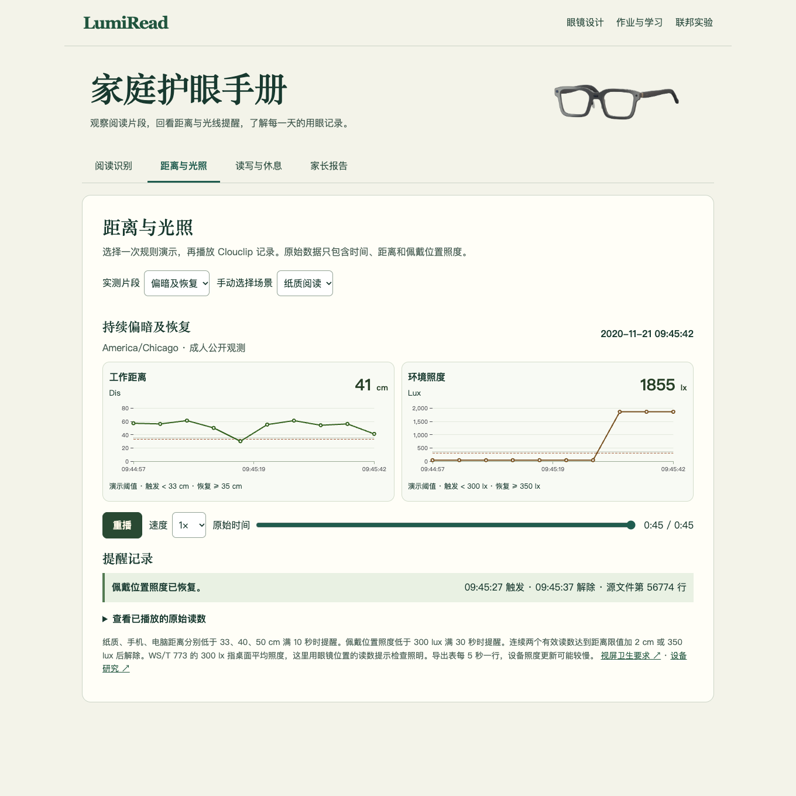

# LumiRead · 家庭护眼手册

LumiRead 在电脑上回放真实眼镜记录，让家长查看模型判定的阅读片段、距离与光线提醒的原始时刻，以及每周的有效观测时长。首页包含阅读与媒介识别、距离与光照提醒、读写计时、用眼建议，以及家长日报和周报。智能眼镜与夹片为产品概念设计。

[实验结果](docs/PUBLIC_RESULTS.md) · [英文商业与机器学习报告](reports/LumiRead_Business_and_ML.pdf) · [离线路演稿（下载 HTML 后用浏览器打开）](reports/LumiRead_Roadshow.html)

## 在本机运行

准备 Python 3.11、uv、Node.js 22+、pnpm 和 make，在项目根目录执行以下命令。

```sh
make bootstrap
make demo
```

打开[家庭护眼手册](http://127.0.0.1:8742/)。仓库内的冻结预测、Clouclip 读数和模拟周报可直接回放。原始研究录像按 Meta 的数据访问流程单独获取。下载 Explorer 清单后，运行 `make ritw-preview MANIFEST=/absolute/path/to/ritw_download_urls.json`，刷新阅读识别页即可看到与时间轴同步的授权视频。[官方入口](https://explorer.projectaria.com/ritw) · [完整复现步骤与数据许可](ml/ritw/README.md)

| 护眼手册入口 | 可以核对的内容 |
| --- | --- |
| [阅读识别](http://127.0.0.1:8742/#reading) | 切换 30 段留出录像，对照官方标注、模型判定的阅读与媒介、有效覆盖和累计时长。 |
| [距离与光照](http://127.0.0.1:8742/#sensors) | 选择纸质、手机或电脑场景，播放偏近、偏暗和恢复片段，逐条核对源文件行号。 |
| [读写与休息](http://127.0.0.1:8742/#timer) | 纸质读写满 40 分钟，电子学习满 30 分钟提醒，建议远眺约 10 分钟。可切换到规则演示推进时间。 |
| [家长报告](http://127.0.0.1:8742/#reports) | 查看 RitW 阅读记录、Clouclip 提醒或标明「模拟学生」的完整七天。点击日期，查看覆盖时间、建议与明细。 |

Meta RitW Seattle 实验按官方划分抽取 96 段成人记录。30 段测试录像共 5,874 个有效秒，Meta 模型的阅读 F1 为 **0.782**，自训逻辑回归为 **0.694**。纸质、电子和物体文字的官方模型召回率分别为 22.6%、28.0%、26.5%。距离提醒由使用者手动指定场景。Clouclip 是另一项成人观测研究，两份实测报告各自汇总。模拟周报展示的是虚构学生。运行 `make ritw-check` 可用冻结预测重新核算指标，并验证提醒和计时边界。[实验方法和结果](ml/ritw/README.md) · [Clouclip 数据说明](data/clouclip/README.md)



## 眼镜设计与作业学习

运行 `make demo-accounts` 准备作业学习的三个演示账号。程序会下载指定版本的 ASSISTments 数据，校验 SHA-256，再从验证集重建三个匿名学习者的作答历史。如果已有同一份 ZIP，可直接运行 `make demo-accounts ARCHIVE=/absolute/path/to/assistments2009.zip`。知识追踪模型随仓库提供，可直接在 CPU 上运行。[数据来源与重建步骤](data/dkt/README.md)

如需使用在线批改，在启动服务前将 `OPENAI_API_KEY` 配置到后端环境变量或 `apps/api/.env`。可从 `apps/api/.env.example` 复制配置，并用 `OPENAI_MODEL` 指定账号可访问的图像模型。批改时，后端将作业图像发给所配置的视觉服务，调用按提供商规则计费。本机数据库与上传图片保存在 `var/`。

| 本机入口 | 可以尝试 |
| --- | --- |
| [产品展示](http://127.0.0.1:8742/showcase) | 转动眼镜，查看框架结构和佩戴方式。 |
| [家长学习手册](http://127.0.0.1:8742/app) | 选择「登录 B」，在「作业批改」依次上传[原题页](data/demo/worksheet-original.png)与[订正页](data/demo/worksheet-revised.png)。第二题的答案由 8 改为 5，可对照两次判分。 |
| [联邦学习实验](http://127.0.0.1:8742/federated) | 查看三次 FedAvg 实验的验证曲线、测试指标与通信量。 |

家长手册还可以回放工作距离与照度。每个演示账号配对了同一名成年受试者公开记录中的一个时间窗，回放保留原始时间与测量值。学习历史和护眼记录来自两个独立研究。[Clouclip 记录与取样规则](data/clouclip/README.md)

## 作业学习实验

六类数学知识点的预测任务按学生划分训练、验证与测试集。下表使用同一批 355 名留出学生的 6,694 次首次作答。家长手册使用集中式 DKT 更新个人预测，LightGBM 在三种方法中取得最高的测试 ROC AUC。

| 方法 | 测试 ROC AUC |
| --- | ---: |
| LightGBM | 0.7024 |
| 集中式 LSTM DKT | 0.6894 |
| FedAvg DKT（验证集选定模型） | 0.6646 |

FedAvg 在一台机器上模拟 1,653 个学生客户端，每轮抽取 64 个，独立运行三个随机种子，每个种子训练 60 轮。三个种子的测试 ROC AUC 均值为 0.6576，样本标准差为 0.0061。[模型卡](docs/MODEL_CARD.md) · [联邦实验完整结果](artifacts/federated/report.json)

在线批改评估通过常规上传入口提交了 24 张程序排版的数学作业截图。六类题型各 20 题，120 题全部获得自动判分，其中 119 题与预先计算的答案一致（99.17%）。这次评估只覆盖排版截图，真实手写字迹、倾斜拍摄和阴影条件下的准确率仍待评估。[逐题批改汇总指标](reports/vision_evaluation.json)

## 仓库导览

| 目录 | 内容 |
| --- | --- |
| `apps/web`、`apps/api` | React / TypeScript 前端，FastAPI 后端、批改任务和 SQLite 存储。 |
| `ml`、`artifacts` | RitW 推理、自训基线、集中式与联邦训练、冻结模型和测试结果。 |
| `data`、`packages/contracts` | 数据来源、知识点映射、演示题页及前后端接口定义。 |
| `scripts`、`tests` | 本机启动和验证脚本、模型与应用回归测试。 |

护眼彩排可运行 `make rehearse-eyecare`，其中原始录像同步用例需要本机已领取授权预览。

已完成账号数据重建后，运行 `make test-accounts test-clouclip test-grading test-learning-loop` 可以检查账号隔离、传感器回放、批改修订与练习流程。

在 Git 克隆中运行 `make package`，可将当前提交的公开源码和许可证导出到 `release/LumiRead-source.zip`。

## 许可与数据来源

Meta 的 Seattle 数据、参考模型与本项目的 RitW 衍生产物遵循 CC BY-NC 4.0，限非商业用途。[作者、许可与修改说明](ml/ritw/README.md#attribution-and-use)

LumiRead 的原创代码采用 [MIT 许可证](LICENSE)。第三方数据和素材遵循各自的来源条款。ASSISTments 学生级记录由使用者从数据发布方独立获取。Clouclip 示例附有上游 MIT 许可。归档视觉实验的照度表格和手写视频分别采用 CC BY 4.0 和 CC BY 3.0。[ASSISTments 数据说明](data/dkt/README.md) · [Clouclip 许可](data/clouclip/LICENSE) · [视觉实验署名与许可](data/vision/original/README.md)
