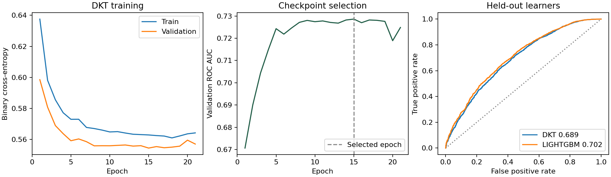

# LumiRead 知识追踪模型卡

**当前冻结版本为 `dkt-lstm-f596e77e7b94`。** 输入一名学生按时间排列的知识点和判分，输出下一道同类题首次答对的六个概率。留出 355 名学生的 6,694 次作答后，DKT 的 ROC AUC 为 0.6894，LightGBM 为 0.7024。此版本在 NVIDIA GeForce RTX 4080 SUPER 上训练，在演示机 arm64 CPU 上推理和复评。训练设备、软件版本和冻结权重的散列可独立核验。[训练记录](../artifacts/dkt/training.json) · [校验清单](../artifacts/dkt/checksums.json)

## 作答来源与六类覆盖

数据来自 ASSISTments 2009–2010 corrected Skill Builder 的 USTC 非折叠版。保留有明确技能标签、可判分的主问题，以首次作答判分为标签，排除引导子题和自动判对的开放题。先合并同一次作答的标签，再按学生隔离。每名学生内部使用原始问题日志的时间顺序。训练、验证、测试分别有 1,653、354、355 名学生。训练期的所有调参和选轮仅使用前两组，独立测试组共 4,468 次答对，2,226 次答错。[来源、许可与重建方法](../data/dkt/README.md)

| 知识点 | 训练作答 | 验证作答 | 测试作答 | 测试答对 | DKT AUC | LightGBM AUC |
| --- | ---: | ---: | ---: | ---: | ---: | ---: |
| 四则混合运算 | 4,016 | 879 | 782 | 499 | 0.6435 | 0.6364 |
| 分数通分约分 | 9,926 | 2,087 | 2,263 | 1,481 | 0.7128 | 0.7164 |
| 小数乘除 | 1,326 | 293 | 351 | 272 | 0.7117 | 0.7423 |
| 简易方程 | 12,132 | 2,715 | 2,464 | 1,623 | 0.6747 | 0.6949 |
| 几何面积 | 2,409 | 666 | 616 | 407 | 0.6254 | 0.6702 |
| 应用题列式 | 859 | 210 | 218 | 186 | 0.6358 | 0.6629 |
| **合计** | **30,668** | **6,850** | **6,694** | **4,468** | **0.6894** | **0.7024** |

分数维度覆盖等值分数与分数加减，标签可包含同分母题，不能从原数据单独区分每次是否需要约分。应用题列式仅覆盖由情境写一次方程。面积覆盖六种平面图形。逐标签依据及原始计数可见映射和数据摘要。[技能映射](../data/dkt/skill_mapping.json) · [划分摘要](../data/dkt/summary.json)

## 模型与评估

DKT 使用 12 维作答嵌入、24 单元单层单向 LSTM 与六路 sigmoid 输出。每条学生记录从统一的序列开始符预测第一题，此后每次只输入前一题的知识点与判分，选择当前目标知识点对应的输出训练。完整序列保留，训练采用掩码交叉熵、批量 64、Adam 学习率 0.003、随机种子 6083，按验证 AUC 早停。21 轮内第 15 轮验证 AUC 最高，达到 0.7286。[训练记录](../artifacts/dkt/training.json)

LightGBM 使用同一批目标。输入包括当前技能、过往作答次数及平滑正确率、该技能历史、上次作答结果、与上次同类题的间隔和近五题正确率。首次作答可用的特征只有当前技能与固定初始值。验证集选择第 172 棵树。两者均以 0.5 为分类阈值，以答对作为正类，按作答次数加权汇总。[基线实现](../ml/baselines/lightgbm.py) · [全量指标](../artifacts/dkt/metrics.json)

| 模型 | ROC AUC | Accuracy | F1 | Log loss | 真负 | 假正 | 假负 | 真正 |
| --- | ---: | ---: | ---: | ---: | ---: | ---: | ---: | ---: |
| DKT LSTM | 0.6894 | 0.7051 | 0.8046 | 0.5772 | 655 | 1,571 | 403 | 4,065 |
| LightGBM | 0.7024 | 0.7075 | 0.8036 | 0.5691 | 731 | 1,495 | 463 | 4,005 |

LightGBM 对答对、答错的总体排序略好。DKT 在此阈值下少漏判 60 次正确作答，同时多误判 76 次错误作答。未使用中国家庭纸面作业对上述概率做独立校准。原数据的练习编排、做对三题即停止的机制，以及请求提示记错都会影响分布。空历史使用训练得到的群体预测，其中以小数或应用题作为第一题的训练学生分别只有 20、21 人。家长端应同时展示该学生的各类作答数，避免把这一分数解释为课程达标率。[原始数据定义](https://sites.google.com/site/assistmentsdata/home/2009-2010-assistment-data)



## 本机推理与复验

后端调用 `ml.dkt.inference.predict(history)`，其中每次作答是 `(skill_id, bool)`。函数返回六个浮点概率。`model_info()` 返回权重版本、实际 CPU 设备及可用状态。部署使用标准库实现与 PyTorch 相同的四个 LSTM 门，现场环境仅需 Python。缺失文件或校验失败时会报告模型不可用。五条预定义输入覆盖空历史、正确、错误、六类混合和 72 次较长历史。下载后在演示机核对全部 7 个文件的 SHA-256，30 个 CPU 输出相对云端 CUDA 参考的最大绝对差为 `3.78031 × 10⁻⁵`，通过 `10⁻⁴` 门槛。两个本机 Python 环境均对完整留出测试集重算，复现了两种模型的 AUC、Accuracy、F1 和混淆矩阵。把线上 CPU 函数逐一用于全部 6,694 个测试答案的历史前缀，其输出与同权重 CPU PyTorch 最大相差 `1.84 × 10⁻⁷`。[CPU 推理](../ml/dkt/inference.py) · [参考输入输出](../artifacts/dkt/parity.json)

从项目根目录执行以下命令。第一条只校验随包模型，无需训练依赖或网络。训练环境使用 Python 3.11，并与后端隔离。macOS 上的 LightGBM 依赖 OpenMP 运行库。下载过的数据可离线重建。机器上已有训练环境时可设置 `TRAIN_PYTHON=/path/to/python`。

```sh
make -f ml/dkt/Makefile check
make -f ml/dkt/Makefile setup PYTHON=python3.11
make -f ml/dkt/Makefile prepare
make -f ml/dkt/Makefile evaluate
make -f ml/dkt/Makefile train DEVICE=cpu OUT=.cache/dkt/local-rerun
make -f ml/dkt/Makefile check OUT=.cache/dkt/local-rerun
```

云端训练使用 Linux x86_64、Python 3.12.3、PyTorch 2.5.1+cu124、CUDA 12.4、NumPy 2.1.3、LightGBM 4.7.0、scikit-learn 1.9.1、Matplotlib 3.9.2。演示机另设 Python 3.11 CPU 评测环境。用相同 CUDA 构建复训时，先确认 PyTorch 可识别目标 GPU，回传新模型目录后在演示电脑核对训练设备来源与本机对齐误差。每位研究者在自己的机器下载学生数据，跨机器仅复制源码、可分发配置和模型产物。[云端依赖版本](../ml/dkt/cuda-reference.txt) · [本机依赖版本](../ml/dkt/cpu-reference.txt)

```sh
make -f ml/dkt/Makefile train DEVICE=cuda TRAIN_PYTHON=python3 OUT=artifacts/dkt-cuda
make -f ml/dkt/Makefile check-cuda OUT=artifacts/dkt-cuda
```

## 单机 FedAvg 模拟与中央模型对照

2026 年 11 月 23 日在本机 CPU 上独立运行三个种子，每个种子完成 60 轮。每位训练学生代表一个模拟终端，共 1,653 个。每轮按种子无放回抽取 64 个终端，终端从相同的本轮全局权重开始，在自己完整的历史上运行 3 个 SGD epoch。服务器按各终端的有效预测目标数对更新后的模型参数求加权平均。一个学生的首题贡献一个目标，填充位贡献零，重复本地训练不会改变各终端的相对权重。三种模型共享原有的学生隔离划分，家长端仍使用已冻结的中央 DKT。[预注册协议](../data/dkt/federated_protocol.json) · [实验报告](../artifacts/federated/report.json)

协议在运行前固定种子 6083、16083、26083，固定学习率 0.30、梯度裁剪 5 和上述训练预算。每次从头初始化，按验证 AUC 选轮，平局取较早轮次。三个种子的候选之间仍按验证 AUC 决定默认模型，平局取较小种子。所有选择冻结后才对联邦模型打开测试集。三次独立运行的结果全部保留。[逐轮实际日志](../artifacts/federated/rounds.jsonl) · [校验清单](../artifacts/federated/checksums.json)

| 种子 | 验证选定轮 | 验证 AUC | 测试 AUC | 测试 Brier |
| ---: | ---: | ---: | ---: | ---: |
| 6083 | 60 | 0.6946 | 0.6544 | 0.2048 |
| **16083** | **58** | **0.6995** | **0.6646** | **0.2030** |
| 26083 | 60 | 0.6926 | 0.6538 | 0.2046 |

默认联邦导出为 `fedavg-dkt-f37430dcacc7`。三个种子的测试 AUC 均值为 0.6576，样本标准差为 0.0061。测试集共有 355 名学生、6,694 个首次作答目标。下表的短历史部分取该学生当前题之前已有 0–4 次映射作答的 1,519 个目标。所有分类采用 0.5 阈值，F1 正类为答对。Brier 分数为预测概率与二元结果的均方差，越小越好。[完整指标、分技能结果与四组历史长度](../artifacts/federated/report.json)

| 模型 | 全体 AUC | Accuracy | F1 | Brier | 短历史 AUC | 短历史 Accuracy | 短历史 F1 | 短历史 Brier |
| --- | ---: | ---: | ---: | ---: | ---: | ---: | ---: | ---: |
| 中央 DKT | 0.6894 | 0.7051 | 0.8046 | 0.1960 | 0.6752 | 0.6392 | 0.7249 | 0.2142 |
| FedAvg DKT | 0.6646 | 0.7008 | 0.8085 | 0.2030 | 0.6615 | 0.6564 | 0.7672 | 0.2174 |
| LightGBM | 0.7024 | 0.7075 | 0.8036 | 0.1930 | 0.6834 | 0.6557 | 0.7217 | 0.2121 |

联邦模型在本划分下更常预测答对，整体召回率为 0.9465，精确率为 0.7057。以答对为正类，其全体测试混淆矩阵为 `[[462,1764],[239,4229]]`。它的正类 F1 略高，排序与概率误差两项都落后于已冻结的中央 DKT 和 LightGBM。全程在一个进程中模拟多终端。日志中的上下行字节数按每个参与方传输一份完整 FP32 参数计算，未测量真实设备通信。实验没有实现差分隐私、安全聚合或设备掉线处理。实验报告中的 Accuracy、F1 和概率均采用 0–1 标度。

本机用同一预注册配置完整复训一次，两个实验的 180 轮客户端选择、有效目标数、损失、验证指标、更新范数以及默认 CPU 权重完全一致。每轮实测耗时因运行环境而变化。另在 6,694 个测试前缀逐条执行联邦 CPU 推理，与同权重 PyTorch 的最大绝对差为 `9.99 × 10⁻⁸`。项目的家长端使用中央版本，`/federated` 独立展示本实验结果。

```sh
make -f ml/dkt/Makefile federated-check
make -f ml/dkt/Makefile federated-evaluate
make -f ml/dkt/Makefile federated-train FED_OUT=.cache/dkt/federated-rerun
make -f ml/dkt/Makefile federated-check FED_OUT=.cache/dkt/federated-rerun
```

## 三个演示账号的历史

先固定选样标准，再从验证学生中按稳定哈希顺序选择三个不同学生，若某类无匹配才查询测试集。本次三类账号均有验证集匹配。筛选只读取映射题量与技能分布，完整保留选中学生的顺序。A 代表初次观察，选 3–5 次历史。B 代表专项练习，选 12–45 次历史，且主技能至少 12 次、占比至少 70%。C 代表综合观察，至少 40 次历史、覆盖至少 4 种技能。筛选不使用学生答对情况或模型预测。[预注册选择规则](../data/dkt/demo_selection.json)

真实的演示记录仅在演示机本地生成。`problem_log_id` 取原始 `order_id`，学生历史按数值升序。固定 ZIP 的 30 列中，`ms_first_response` 与 `overlap_time` 都是持续毫秒数。每个事件的 `observed_at` 因而保留为空。按数据条款，发布包可附选择规则和标准库生成器，逐学生 JSON 与由其生成的数据库应留在演示机。[数据权限与来源](../data/dkt/README.md)
